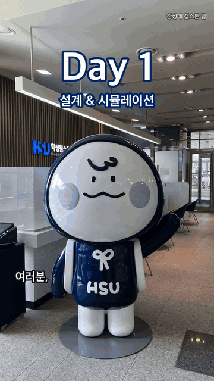

<picture>
  <source media="(prefers-color-scheme: dark)" srcset="https://raw.githubusercontent.com/gawbi/gawbi/main/assets/banner-dark.svg" />
  <source media="(prefers-color-scheme: light)" srcset="https://raw.githubusercontent.com/gawbi/gawbi/main/assets/banner-light.svg" />
  
</picture>

 

**AI 네이티브 인재가 로봇으로 현장 문제를 풉니다.**

해양 충전, 건설 용접, 자율주행, 식품 선별, 국방, 교육 홍보까지 현장에서 직접 부딪히고 있습니다.

     

안녕하세요, 될 때까지 들이받는 '박치기공룡' 김광빈입니다.

현대차 의왕연구소에서 전기차를 스스로 충전하는 로봇팔을 본 후, 저는 그 기술을 파도에 흔들리는 전기 선박 위로 옮기고 있습니다. 사람이 직접 붙어 있어야 했던 위험한 항구의 충전 작업을 로봇에게 온전히 맡기는 것이 제 목표입니다.

건설 현장에서는 숙련 용접공의 위빙 손기술을 로봇이 배워 그대로 재현하도록 만드는 산학 과제를 하고 있습니다. 비공개 과제라 자세한 내용은 공개하기 어렵습니다.

또한, Isaac Sim에서만 달리던 차를 실제 트랙에 올려두고, 가상에서 완주하던 모델이 현실에서 왜 벗어나는지 그 간극(Sim-to-Real)을 하나씩 집요하게 좁혀가고 있습니다. 정답을 찾을 때까지 현실의 문제에 부딪치고 증명하겠습니다.

새벽 4시 50분, 골프장 일을 마치고 곧장 학교로 향했습니다. 주 69시간을 일하며 24학점을 들었고, 모자란 시간을 메우려고 Claude로 일정 관리 앱을 직접 만들어 썼습니다. 그때부터 AI는 제 손에 익은 도구가 됐고, 그렇기에 AI가 낸 숫자일수록 먼저 의심하고 직접 검증합니다.
처음에는 쉬지 않고 달리는 방법만 고집했지만, 그 방식은 제게 맞지 않았습니다. 대신 넘어져도 다시 일어나는 법을 터득했고, 그 덕분에 더 단단해졌습니다.

포트폴리오: [gawbi.github.io/lab](https://gawbi.github.io/lab/)

 

### 카메라 자율주행 Sim-to-Real

[track-digital-twin](https://github.com/gawbi/track-digital-twin/tree/feat/isaac-sim-rtx5070)

수업용 자율주행 트랙을 Isaac Sim 5.1에 옮겨 놓고, 카메라 영상만 보고 운전하는 CNN을 학습해 Raspberry Pi 5 차량에서 돌리고 있습니다.
시뮬레이터에서는 10번 모두 완주한 모델이 실제 트랙에서는 커브 4곳에서 전부 벗어났고, 그 차이가 어디서 오는지 찾는 중입니다.

지금까지 찾은 원인은 이렇습니다.

- 실차가 벗어난 곳은 모두 조명이 매트에 반사되는 모서리였습니다. 같은 모델에 반사와 밝기 변화를 주면 시뮬레이터에서도 5번 모두 1m 안에서 이탈했습니다.
- 시뮬레이터의 바퀴는 제자리 회전을 명령의 3~9%밖에 재현하지 못했습니다. 실차에서 잰 회전 효율(0.43)로 스키드 조향 모델을 다시 만들었습니다.
- 전체 조향 오차는 세 모델 모두 0.17 정도로 비슷했는데, 커브만 따로 보니 꺾는 양이 사람 운전의 절반도 안 됐습니다. 그래서 평가를 직선과 커브로 나눴습니다.

합성 데이터만, 실제 데이터만, 합성 후 실제로 미세조정한 모델 세 가지를 같은 차로 비교했고, 지금은 반사 조건을 넣은 데이터로 다시 학습하고 있습니다.

 

### 휴머노이드 보행 강화학습

[robotics-rl-study](https://github.com/gawbi/robotics-rl-study)

PPO를 직접 짜서 CartPole로 확인한 뒤, Isaac Lab에서 Unitree G1의 평지 보행을 학습했습니다(4,096개 환경, 1,500 iteration, 약 27분).
발을 들어 올리는 보상(`feet_air_time`) 하나만 끄고 다시 학습해 보니, 넘어지는 비율과 명령 추종은 거의 같았고 발 미끄러짐 벌점만 32% 커졌습니다.
시드 하나로 본 결과라 시드를 늘려 다시 확인할 생각입니다.

 

### 말하고 걷는 상상부기 (캡스톤 준비)

한성대 마스코트 상상부기 모양의 이족보행 로봇입니다. [Open Duck Mini v2](https://github.com/apirrone/Open_Duck_Mini)의 다리를 그대로 쓰고, 실물을 만들기 전에 MuJoCo로 외형부터 맞춰 봤습니다.
동상 비율대로 만들면 무게중심이 발 뒤로 가서 서지 못했고, 몸통과 머리를 앞으로 옮기고 배터리를 배 쪽으로 내려서 해결했습니다. 원본 보행 정책을 부기 무게 모델에 그대로 돌려 13초 동안 86cm를 걸었습니다.
실물 제작과 부기용 정책 학습은 다음 학기에 합니다. 학교 캐릭터를 쓰는 프로젝트라 저장소는 비공개입니다(캐릭터, 로고 © 한성대학교).

 

### 이전 프로젝트

**[haegeum-addon](https://github.com/gawbi/haegeum-addon)**
UAV, UGV 센서가 조작됐는지 VAE 재구성 오차로 잡는 ROS2 모듈입니다. 공격을 만드는 에이전트를 따로 짜서 검증했고, 추론은 CPU 한 스레드에서 p99 0.041ms(UGV)였습니다. SHAP을 붙이다가 예전 분석에서 틀린 부분을 찾아 고쳤습니다.

**[hc-roberta-cross-attention](https://github.com/gawbi/hc-roberta-cross-attention)**
수치 피처와 텍스트 임베딩을 Cross-Attention으로 합치는 분류기입니다. F1 0.9832가 나왔는데 TF-IDF만 써도 0.9744가 나와서, 점수 대부분이 데이터셋 자체의 단서에서 온다는 걸 같이 적어 뒀습니다.

**[voice-deepfake-detection](https://github.com/gawbi/voice-deepfake-detection)**
멜 스펙트로그램과 웨이블릿 스칼로그램을 두 채널로 넣은 ResNet-18입니다(해커톤). EER이 5.50%에서 3.80%로 내려갔지만 두 실험의 입력 길이와 배치가 달라서, 웨이블릿 덕분이라고는 쓰지 않았습니다.

그 밖에 [MENDAI](https://github.com/gawbi/MENDAI)(운동화 손상 탐지, 팀), [robotics-from-scratch](https://github.com/gawbi/robotics-from-scratch)(2링크 팔 기구학 공부), [robotics-roadmap](https://gawbi.github.io/robotics-roadmap/#/me)(로보틱스 공부 기록 사이트), [legacy-archive](https://github.com/gawbi/legacy-archive)(2020년 C/C++ 수업 코드)가 있습니다.

 

### 비공개로 진행 중인 것

데이터가 기관 소유이거나 발표 전 연구라서 코드를 올리지 못한 작업입니다.

- **PlugBot** (해커톤): SO-101 로봇팔로 파도에 흔들리는 선박 충전 소켓에 플러그를 꽂습니다. MuJoCo에서 카메라 지연을 넣고 비교해 보니, 파고 8cm에서 최신 위치를 따라가는 방식은 6.7%, 0.3초 뒤를 예측해 꽂는 방식은 80% 성공했습니다. 실물 실험을 준비하고 있습니다.
- **숙련 용접공 위빙 자동화** (산학 과제): 숙련공의 손기술을 로봇이 배워 재현하게 하는 과제입니다. 기업과의 과제라 내용은 공개하기 어렵습니다.
- **VLM 보조 라벨링**: 로봇 과제의 성공/실패를 로컬 VLM이 먼저 판단하고 사람은 일부만 검토하는 파이프라인입니다. 연구실 발표 전입니다.
- **보상 기반 critic shaping 연구 인수인계**: 지도교수님 연구의 원본 결과를 다시 집계해 확인하고 인수인계 자료를 정리했습니다.
- **라만 스펙트럼 전처리** (2026.01~07): 선행 연구자의 RSGAN, RSBPCNN 구현을 이어받아 개선했습니다. 원 구현의 공개 동의를 기다리고 있습니다.

 

### 사용하는 도구

